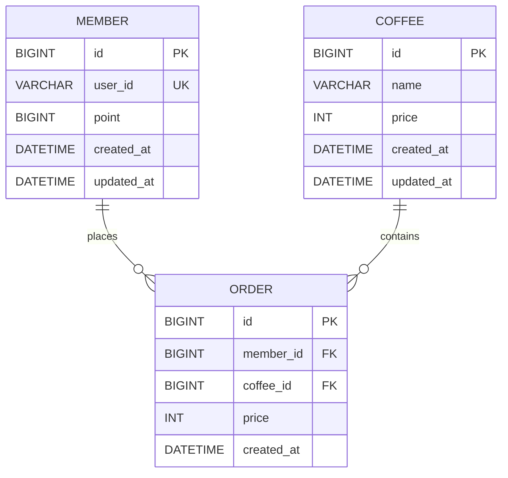

# ☕ Coffee Order System

다수 서버 환경에서도 안정적으로 동작하는 커피숍 주문 시스템입니다.

커피 메뉴 조회, 포인트 충전 및 주문 기능을 제공하며, 주문 내역을 기반으로 인기 메뉴를 조회할 수 있도록 구현했습니다.

특히 여러 서버에서 동시에 포인트 충전 및 주문 요청이 발생하는 상황을 고려하여 **데이터 정합성을 유지하는 것**을 주요 설계 목표로 삼았습니다.

---

## 1. 프로젝트 개요

### 주요 기능

* 커피 메뉴 목록 조회
* 사용자 포인트 충전
* 포인트를 이용한 커피 주문
* 주문 내역 조회
* 인기 메뉴 조회

### 핵심 고려사항

이번 프로젝트에서는 단순한 CRUD 구현뿐만 아니라 다음 문제를 중요하게 고려했습니다.

* 여러 서버에서 동시에 요청이 발생하는 상황
* 포인트 충전 및 차감 과정에서의 데이터 정합성
* 동시에 여러 주문이 발생했을 때 포인트가 잘못 차감되는 문제
* 주문 내역을 기반으로 인기 메뉴를 효율적으로 조회하는 방법

---

# 2. 설계 내용

## 2.1 ERD



### 테이블 설명

#### Member

사용자 정보와 현재 보유 포인트를 관리합니다.

| 컬럼         | 타입       | 설명        |
| ---------- | -------- | --------- |
| id         | BIGINT   | 사용자 식별자   |
| user_id    | VARCHAR  | 사용자 식별값   |
| point      | BIGINT   | 현재 보유 포인트 |
| created_at | DATETIME | 생성일       |
| updated_at | DATETIME | 수정일       |

#### Coffee

판매하는 커피 메뉴를 관리합니다.

| 컬럼         | 타입       | 설명     |
| ---------- | -------- | ------ |
| id         | BIGINT   | 메뉴 식별자 |
| name       | VARCHAR  | 메뉴 이름  |
| price      | INT      | 메뉴 가격  |
| created_at | DATETIME | 생성일    |
| updated_at | DATETIME | 수정일    |

#### Order

사용자의 주문 정보를 관리합니다.

| 컬럼         | 타입       | 설명       |
| ---------- | -------- | -------- |
| id         | BIGINT   | 주문 식별자   |
| member_id  | BIGINT   | 주문 사용자   |
| coffee_id  | BIGINT   | 주문 메뉴    |
| price      | INT      | 주문 당시 가격 |
| created_at | DATETIME | 주문일      |

주문 당시의 가격을 `Order.price`에 저장하여, 이후 커피 메뉴의 가격이 변경되더라도 과거 주문 금액이 변경되지 않도록 설계했습니다.

---

# 3. API 명세서

## 3.1 커피 메뉴 목록 조회

### Request

```http
GET /api/coffees
```

### Response

```json
[
  {
    "id": 1,
    "name": "아메리카노",
    "price": 3000
  },
  {
    "id": 2,
    "name": "카페라떼",
    "price": 4000
  }
]
```

---

## 3.2 포인트 충전

### Request

```http
POST /api/points/charge
Content-Type: application/json
```

```json
{
  "userId": "user1",
  "amount": 10000
}
```

### Response

```json
{
  "userId": "user1",
  "point": 10000
}
```

### Validation

* `userId`는 필수값입니다.
* 충전 금액은 1 이상이어야 합니다.
* 1원은 1포인트로 환산됩니다.

---

## 3.3 커피 주문

### Request

```http
POST /api/orders
Content-Type: application/json
```

```json
{
  "userId": "user1",
  "coffeeId": 1
}
```

### Response

```json
{
  "orderId": 1,
  "coffeeName": "아메리카노",
  "price": 3000
}
```

### 주문 처리 과정

```text
주문 요청
   ↓
사용자 조회
   ↓
커피 메뉴 조회
   ↓
포인트 확인
   ↓
포인트 차감
   ↓
주문 생성
   ↓
트랜잭션 Commit
```

포인트가 부족한 경우 주문을 생성하지 않고 예외를 반환합니다.

---

## 3.4 인기 메뉴 조회

### Request

```http
GET /api/coffees/popular
```

### Response

```json
[
  {
    "coffeeId": 1,
    "name": "아메리카노",
    "orderCount": 120
  },
  {
    "coffeeId": 2,
    "name": "카페라떼",
    "orderCount": 80
  }
]
```

주문 데이터를 기준으로 메뉴별 주문 횟수를 집계하여 인기 메뉴를 조회합니다.

---

# 4. 설계의 의도

## 4.1 관심사에 따른 계층 분리

Spring의 일반적인 계층형 구조를 사용했습니다.

```text
Controller
    ↓
Service
    ↓
Repository
    ↓
Database
```

각 계층의 역할을 명확하게 분리했습니다.

### Controller

HTTP 요청과 응답을 담당합니다.

### Service

실제 비즈니스 로직을 담당합니다.

예:

* 포인트 충전
* 포인트 잔액 확인
* 포인트 차감
* 주문 생성

### Repository

데이터베이스에 접근하는 역할을 담당합니다.

이렇게 계층을 분리하면 비즈니스 로직과 HTTP 처리 로직이 섞이는 것을 방지할 수 있고, 각 계층을 독립적으로 테스트하기 용이합니다.

---

## 4.2 Entity와 DTO 분리

API 응답에서 Entity를 직접 반환하지 않고 DTO를 사용했습니다.

```text
Entity
  ↓
Service
  ↓
DTO
  ↓
Controller
```

Entity는 데이터베이스 구조와 비즈니스 상태를 관리하는 역할을 하고, DTO는 API에서 필요한 데이터만 전달하는 역할을 담당하도록 분리했습니다.

이를 통해 데이터베이스 구조가 API 응답에 직접 노출되는 것을 방지했습니다.

---

## 4.3 주문 당시 가격 저장

주문 테이블에 `price`를 별도로 저장했습니다.

예를 들어:

```text
아메리카노 현재 가격 = 4,000원
```

이더라도 과거에:

```text
아메리카노 = 3,000원
```

일 때 주문했다면 과거 주문 가격은 3,000원으로 유지되어야 합니다.

따라서 주문 시점의 가격을 `Order.price`에 저장하도록 설계했습니다.

```text
Coffee.price
    ↓
주문 시점에 복사
    ↓
Order.price
```

이를 통해 메뉴 가격 변경이 기존 주문 데이터에 영향을 주지 않도록 했습니다.

---

# 5. 문제 해결 전략

## 5.1 가장 중요한 문제: 동시성

이번 프로젝트에서 가장 중요하게 고려한 문제는 **동시에 여러 요청이 발생했을 때 포인트가 정확하게 처리되는가**입니다.

예를 들어 사용자의 현재 포인트가 10,000P이고 동시에 두 개의 충전 요청이 들어왔다고 가정합니다.

```text
요청 A → +10,000P
요청 B → +20,000P
```

정상적인 결과는:

```text
10,000 + 10,000 + 20,000
= 40,000P
```

입니다.

하지만 두 요청이 동시에 현재 포인트를 조회하면 다음과 같은 문제가 발생할 수 있습니다.

```text
서버 A → 10,000 조회
서버 B → 10,000 조회

서버 A → 20,000 저장
서버 B → 30,000 저장
```

최종적으로 30,000P가 저장될 수 있습니다.

이를 **Lost Update(갱신 손실)** 문제라고 판단했습니다.

---

# 6. 선택한 동시성 제어 전략

## 비관적 락(Pessimistic Lock)

이번 프로젝트에서는 포인트를 수정할 때 **비관적 락을 사용하는 방식**을 선택했습니다.

Repository에서 다음과 같이 적용합니다.

```java
@Lock(LockModeType.PESSIMISTIC_WRITE)
Optional<Member> findByUserId(String userId);
```

이를 통해 특정 사용자의 포인트를 수정하는 동안 다른 트랜잭션이 동시에 해당 데이터를 수정하지 못하도록 데이터베이스 수준에서 제어합니다.

### 처리 과정

```text
요청 A
  ↓
Member 조회 + Lock
  ↓
포인트 충전
  ↓
Commit
  ↓
Lock 해제
```

동시에 요청 B가 들어온다면:

```text
요청 B
  ↓
Member 조회
  ↓
Lock 대기
  ↓
요청 A Commit
  ↓
Lock 획득
  ↓
최신 포인트 조회
  ↓
포인트 충전
  ↓
Commit
```

따라서 동시에 여러 충전 요청이 발생하더라도 포인트가 누락되지 않도록 설계했습니다.

---

# 7. 비관적 락을 선택한 이유

동시성 문제를 해결하는 방법으로 여러 가지 방법을 고려했습니다.

| 방법                  | 장점                  | 단점                      |
| ------------------- | ------------------- | ----------------------- |
| 동시성 제어 없음           | 구현이 간단함             | 데이터 정합성 문제 발생           |
| Java `synchronized` | 구현이 간단함             | 여러 서버 환경에서 사용할 수 없음     |
| 낙관적 락               | DB Lock을 오래 유지하지 않음 | 충돌 발생 시 재시도 로직 필요       |
| 비관적 락               | DB 수준에서 동시성 제어 가능   | Lock으로 인한 대기 및 성능 저하 가능 |
| Redis 분산 락          | 여러 서버에서 분산 락 가능     | Redis 등 추가 인프라 필요       |

이번 과제에서는 **다수 서버 환경**이라는 요구사항이 있기 때문에 Java의 `synchronized`는 적절하지 않다고 판단했습니다.

예를 들어 서버가 두 대라면:

```text
Server A
synchronized
     ↓
Server A의 요청만 제어


Server B
synchronized
     ↓
별도로 실행
```

`sychronized`는 JVM 내부에서만 동작하기 때문에 다른 서버의 요청까지 제어할 수 없습니다.

반면 데이터베이스의 Lock은 여러 서버가 동일한 데이터베이스를 사용한다면 서버가 여러 대여도 동일한 데이터에 대해 동시성을 제어할 수 있습니다.

따라서 현재 프로젝트 규모와 요구사항에서는 **비관적 락이 가장 단순하면서도 요구사항을 만족할 수 있는 방법**이라고 판단했습니다.

---

# 8. 트랜잭션 전략

포인트 충전은 다음 과정을 하나의 트랜잭션으로 처리합니다.

```text
Transaction 시작
       ↓
회원 조회
       ↓
Pessimistic Lock 획득
       ↓
포인트 증가
       ↓
DB 반영
       ↓
Commit
       ↓
Lock 해제
```

예를 들어:

```java
@Transactional
public PointChargeResponse charge(String userId, long amount) {

    Member member = memberRepository.findByUserId(userId)
            .orElseThrow(() -> new MemberNotFoundException());

    member.chargePoint(amount);

    return new PointChargeResponse(
            member.getUserId(),
            member.getPoint()
    );
}
```

포인트 충전 과정에서 오류가 발생하면 트랜잭션을 Rollback하여 중간 상태가 DB에 반영되지 않도록 했습니다.

---

# 9. 인기 메뉴 조회 전략

인기 메뉴는 주문 데이터를 기준으로 메뉴별 주문 횟수를 집계합니다.

개념적으로 다음과 같은 SQL을 사용합니다.

```sql
SELECT
    coffee_id,
    COUNT(*) AS order_count
FROM orders
GROUP BY coffee_id
ORDER BY order_count DESC;
```

데이터를 모두 Java로 가져온 다음 `Stream`으로 집계하는 방법도 있지만, 주문 데이터가 많아질 경우 많은 데이터를 애플리케이션 서버로 가져와야 합니다.

따라서 집계 연산은 데이터베이스의 `GROUP BY`, `COUNT` 등을 활용하여 DB에서 처리하도록 설계했습니다.

---

# 10. 기술적 선택 이유

## Java 17

현재 Spring Boot 생태계에서 안정적으로 사용할 수 있고, 학습 및 개발 환경에서 사용하고 있는 Java 버전과 동일하여 Java 17을 선택했습니다.

---

## Spring Boot

Controller, Service, Repository 계층을 명확하게 분리할 수 있고 Spring Data JPA를 통해 데이터베이스 접근을 간단하게 구현할 수 있어 선택했습니다.

---

## Spring Data JPA

Entity와 Repository를 기반으로 데이터베이스 접근 코드를 줄이고 객체 중심으로 비즈니스 로직을 작성하기 위해 사용했습니다.

또한 `@Lock`을 이용하여 JPA 레벨에서 비관적 락을 적용할 수 있다는 점도 선택 이유 중 하나입니다.

---

## MySQL

실제 서비스에서 사용할 수 있는 관계형 데이터베이스이며 트랜잭션과 row-level locking을 지원하기 때문에 선택했습니다.

특히 이번 프로젝트에서 중요한 포인트 정합성과 동시성 제어를 데이터베이스 수준에서 처리할 수 있습니다.

---

## Validation

사용자가 잘못된 값을 전달하는 것을 방지하기 위해 Request DTO에 Validation을 적용했습니다.

예:

```java
@NotBlank
private String userId;

@Min(1)
private long amount;
```

이를 통해 잘못된 사용자 식별값이나 0 이하의 충전 금액을 사전에 검증합니다.

---

# 11. 패키지 구조

```text
com.example.coffee
│
├── member
│   ├── controller
│   ├── service
│   ├── repository
│   ├── entity
│   └── dto
│
├── coffee
│   ├── controller
│   ├── service
│   ├── repository
│   ├── entity
│   └── dto
│
├── order
│   ├── controller
│   ├── service
│   ├── repository
│   ├── entity
│   └── dto
│
└── global
    ├── exception
    └── config
```

도메인별로 패키지를 분리하여 각 기능의 책임을 명확하게 구분했습니다.

---

# 12. 테스트 전략

기본적인 기능 테스트뿐만 아니라 동시성 상황을 테스트합니다.

### 포인트 충전 테스트

```text
초기 포인트 = 0

동시에 100개의 요청
각 요청 = +1,000P

예상 결과 = 100,000P
```

동시성 테스트를 통해 포인트가 누락되지 않는지 검증합니다.

### 주문 테스트

```text
초기 포인트 = 10,000P
커피 가격 = 3,000원

동시에 여러 주문 요청

→ 포인트가 음수가 되지 않는지 확인
→ 주문 수와 실제 차감된 포인트가 일치하는지 확인
```

이를 통해 단순히 API가 정상적으로 동작하는 것뿐만 아니라 **동시 요청에서도 데이터 정합성이 유지되는지** 검증합니다.

---

# 13. 구현 후 개선할 수 있는 부분

현재 프로젝트에서는 요구사항과 구현 복잡도를 고려하여 비관적 락을 선택했습니다.

향후 트래픽이 증가한다면 다음과 같은 개선을 고려할 수 있습니다.

* 낙관적 락 + 재시도
* Redis 기반 분산 락
* 포인트 충전/사용 이력 테이블 추가
* 인기 메뉴 조회 결과 캐싱
* 대용량 주문 데이터에 대한 인덱스 추가
* 인기 메뉴 집계 결과를 별도로 관리하는 구조

특히 포인트의 모든 변동 내역을 관리해야 하는 실제 서비스라면 현재 잔액만 저장하기보다 `PointHistory`와 같은 별도의 이력 테이블을 추가하는 것을 고려할 수 있습니다.
